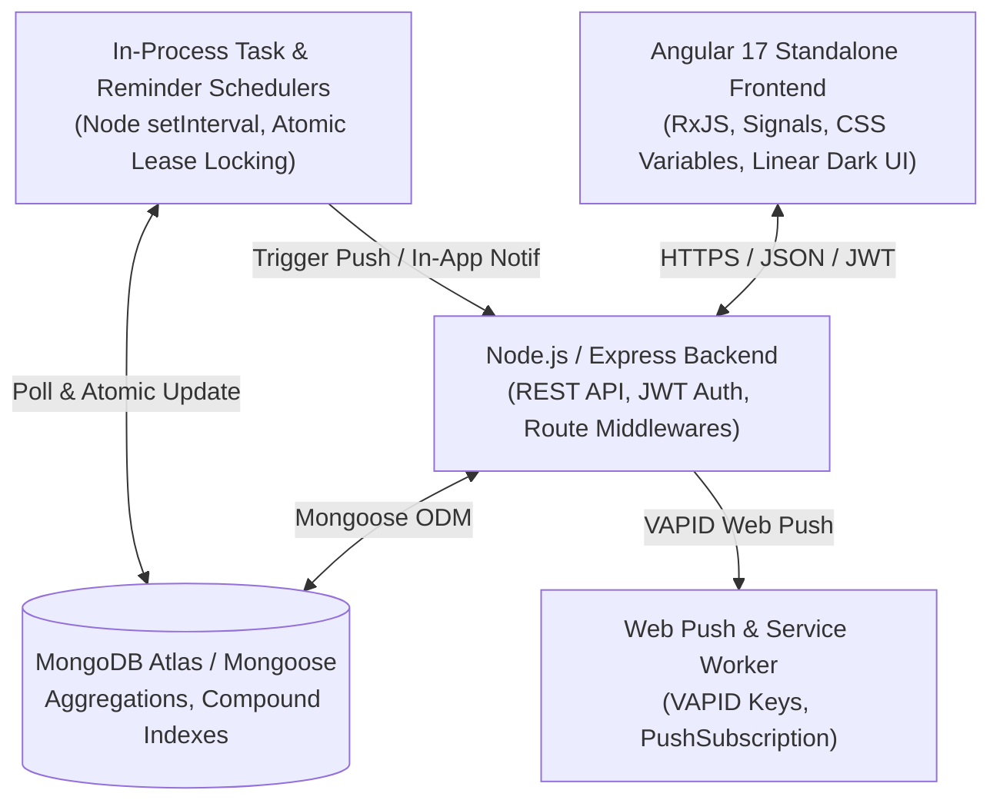

# AI-Assisted Development Learning Document

*PunchUp — Habit Formation, Consistency & Productivity Platform*  
*Full-Stack Implementation Guide: Angular 17, Node.js/Express, MongoDB/Mongoose, Web Push, and AI Pair Programming Architecture*

---

## Table of Contents
1. [Overview & Engineering Goals](#overview--engineering-goals)
2. [Section A: Problem Breakdown & Requirements Analysis](#section-a-problem-breakdown--requirements-analysis)
3. [Section B: Existing Architecture & Technology Stack](#section-b-existing-architecture--technology-stack)
4. [Section C: Solution Design, Engineering Reasoning & Trade-Offs](#section-c-solution-design-engineering-reasoning--trade-offs)
5. [Section D: Production Code Walkthrough & Snippets](#section-d-production-code-walkthrough--snippets)
6. [Section E: Data Model & API Contract Specification](#section-e-data-model--api-contract-specification)
7. [Section F: Testing, Quality Assurance & Debugging Playbook](#section-f-testing-quality-assurance--debugging-playbook)
8. [Section G: Senior Engineering Interview Questions & Deep-Dive Answers](#section-g-senior-engineering-interview-questions--deep-dive-answers)
9. [Section H: Hands-On Practice Exercises & Extension Projects](#section-h-hands-on-practice-exercises--extension-projects)
10. [Production Deployment, Scheduler Durability & Limitations](#production-deployment-scheduler-durability--limitations)

---

## Overview & Engineering Goals

PunchUp is an active production habit formation and productivity platform designed with a dark, Linear-inspired aesthetic. This document serves as the master engineering record for major architectural enhancements and bug remediation executed across the application:
1. **Fixing Community Mobile UI Regressions (Highest Priority)**: Resolving broken comment composer flex layouts and `@mention` autocomplete dropdown stacking context collisions.
2. **Recurring Tasks & Daily Automated Task Generation**: Designing a durable, timezone-aware, idempotent recurring task engine without pre-generating runaway database records.
3. **Admin Dashboard Study & Focus Time Visibility**: Implementing secure server-side aggregations for user study durations across local daily, weekly, and lifetime windows with bounded pagination and sorting.
4. **Leaderboard Personal Rank Highlighting**: Enhancing overall, weekly, league, and focus leaderboards to visually accentuate authenticated user ranks with a golden accent and provide a standalone summary card when outside top 50 without loading the entire user database.
5. **AI-Assisted Pair Programming Pedagogy**: Documenting senior-level engineering decision trees, trade-offs, edge cases, and architectural best practices.

---

## Section A: Problem Breakdown & Requirements Analysis

### 1. Community Mobile UI Regressions
* **Broken Comment Composer Flex Layout**:
  * *Symptoms*: The comment composer input appeared crushed or collapsed into an empty dark box. The "Send" button was detached from the input container, creating visual misalignment. Long multi-line comments did not expand cleanly.
  * *Root Cause*: `<app-mention-dropdown>` had `:host { display: block; position: relative; width: 100%; }` as a direct flex sibling inside `.comment-input-row`. Because flex defaults to `flex-shrink: 1` and treats custom Angular components as layout participants, the dropdown component consumed space and squeezed the text input into zero width. Furthermore, `<input>` lacks auto-expansion capabilities for long text.
* **Mention Dropdown Stacking Context Clipping**:
  * *Symptoms*: Typing `@username` caused the autocomplete popup to be rendered underneath subsequent post cards in the community feed and off-screen on mobile keyboards.
  * *Root Cause*: Feed cards used `position: relative` and CSS keyframe entrance animations (`animation: slideUp 0.3s ease forwards`). Under the CSS Stacking Context Specification, any element with transforms, animations with `forwards`, or non-static positioning creates an isolated stacking context. Consequently, child elements inside card $N$ with `z-index: 9999` are painted *below* card $N+1$, because card $N+1$ is a later sibling in the root stacking context.
* **Component Parameter Mismatch**:
  * *Symptoms*: Selecting a mention inside nested reply boxes erroneously inserted `@user` into parent comment inputs.
  * *Root Cause*: In `community.component.ts`, `onSelectMentionUser` was called with `'reply_' + post._id` instead of `'reply_' + c._id`.

### 2. Recurring Tasks / Daily Task Generation
* **User Habit Automation**: Users practicing daily competitive programming (e.g. "Daily CP") or study goals need PunchUp to automatically generate that day's task instance at a configured local time (e.g., 7:00 AM).
* **Core Non-Negotiables**:
  * Do not pre-generate 365 future task documents in advance.
  * Timezone awareness: Host server UTC time must not cause tasks to generate on the wrong calendar day for users in Asia, Europe, or the Americas.
  * Idempotency: Multiple server restarts, delayed cron runs, or distributed horizontal workers must never create duplicate tasks for the same user and local calendar date.
  * Task Lifecycle Independence: Completing or deleting today's task must not alter or delete the recurring master schedule unless explicitly chosen (`stopRecurrence=true`).

### 3. Admin Dashboard Study Time Visibility
* **Objective**: PunchUp administrators need oversight into users' focused work without downloading thousands of raw timer logs into client memory.
* **Requirements**:
  * Display daily, weekly, and overall accumulated focus time.
  * Strictly filter out active, cancelled, or invalid focus sessions (< 5 seconds).
  * Server-side pagination, sorting by focus duration, user search, and zero exposure of sensitive user credentials.
  * Backend role enforcement via JWT and administrative email checks.

### 4. Leaderboard Current User Rank
* **Objective**: Authenticated users should see their rank immediately stand out with a subtle golden accent across all leaderboard views (overall, weekly, league, focus).
* **Requirements**:
  * Preserve top-3 medals (🥇, 🥈, 🥉) without replacing medal iconography with the personal highlight.
  * If a user is ranked below position 50 (outside the top-50 array returned by the API), compute and return their exact rank and points server-side using efficient count queries, rendering a compact "Your Rank" summary widget.

---

## Section B: Existing Architecture & Technology Stack

PunchUp utilizes a modern full-stack TypeScript and JavaScript architecture:



### Component Details
* **Frontend**: Angular 17 with standalone components (`imports: [CommonModule, FormsModule, RouterLink]`), CSS variable theming, and reactive services (`TaskService`, `FocusService`, `AdminService`, `LeaderboardService`).
* **Backend**: Node.js, Express (CommonJS), Mongoose models (`User`, `Task`, `RecurringTask`, `FocusSession`, `PointEvent`, `Notification`, `PushSubscription`).
* **Security**: `authMiddleware.js` (JWT verification with `protect` and `protect.optional`), `adminMiddleware.js` (role and email enforcement).
* **Database**: MongoDB with high-performance compound indexing, `$facet` pagination pipelines, and atomic `$set` lease mechanisms.

---

## Section C: Solution Design, Engineering Reasoning & Trade-Offs

### 1. CSS Stacking Contexts vs Blind z-index
A naive fix often attempted by junior engineers is setting `z-index: 999999` on child dropdown menus. This fails when parent cards have CSS transitions or transforms (`transform`, `opacity`, `filter`, `perspective`, or `animation ... forwards`). In PunchUp, each feed card created its own local stacking context:

```
Root Stacking Context
├── Card 1 (Stacking Context Level: 0)
│   └── .mention-dropdown-panel (Local z-index: 9999 -> effectively trapped at Level 0)
└── Card 2 (Stacking Context Level: 0 -> painted AFTER Card 1 in DOM order)
```

**The Solution**:
1. Encapsulate `<textarea>` and `<app-mention-dropdown>` inside `.comment-input-wrapper` (`position: relative; flex: 1; min-width: 0;`).
2. Make `<app-mention-dropdown>` absolute (`:host { position: absolute; inset: 0; pointer-events: none; }`), restoring normal flex sizing to the textarea and keeping the submit button perfectly docked.
3. Elevate the parent card's stacking context dynamically: when `@` mention suggestions are open on Card 1, Card 1 receives `.has-active-mention { z-index: 50 !important; }`, ensuring Card 1 sits above Card 2 in the root stacking context.

### 2. Recurrence Scheduling & Idempotency Strategy
* **Why not pre-generate 365 days of tasks?** Pre-generation causes database bloat, creates stale tasks if the schedule changes, complicates mass deletion, and distorts overdue task analytics.
* **Why not client-side setInterval?** Client timers stop as soon as the user closes their browser or smartphone tab.
* **Selected Pattern**: Persistent Schedule + Just-In-Time Generation:
  1. Master Record: `RecurringTask` stores user configuration (`creationTime`, `timeZone`, `startDate`, `endDate`, `nextRunAt`, `lastGeneratedDate`).
  2. Instance Document: `Task` stores `recurringTaskId` (ref) and `recurrenceDate` (string "YYYY-MM-DD").
  3. Database-Level Constraint: Compound unique index on `{ recurringTaskId: 1, recurrenceDate: 1 }` prevents duplicate records even under horizontal scaling or race conditions.
  4. Atomic Lease Claim: Schedulers query `nextRunAt <= now` and atomically advance `nextRunAt` by 5 minutes before executing task creation, preventing duplicate processing across node instances.

### 3. Server-Side Study Time Aggregation ($facet Pipeline)
To prevent N+1 query bottlenecks and unbounded client payload sizes, `getAdminStudyTime` uses a single MongoDB pipeline:
1. `$match`: Filters onboarded, unbanned users matching the optional search regex.
2. `$lookup` with sub-pipeline: Joins `FocusSession` records where `status: 'completed'`.
3. Conditional `$sum`: Computes `todayDuration` (`$gte: startOfDay`), `weeklyDuration` (`$gte: startOfWeek`), and `overallDuration` within the database engine.
4. `$facet`: Produces both paginated results (`$skip`, `$limit`) and total count metadata in a single network round-trip.

---

## Section D: Production Code Walkthrough & Snippets

### 1. Robust Timezone-Aware Recurrence Calculation
```javascript
// backend/src/utils/recurrenceHelpers.js
function getLocalDateString(referenceDate = new Date(), timeZone = 'UTC') {
  try {
    const validTz = (timeZone && typeof timeZone === 'string') ? timeZone.trim() : 'UTC';
    const formatter = new Intl.DateTimeFormat('en-CA', {
      timeZone: validTz,
      year: 'numeric',
      month: '2-digit',
      day: '2-digit',
    });
    return formatter.format(referenceDate); // Returns YYYY-MM-DD
  } catch (err) {
    return new Date(referenceDate).toISOString().split('T')[0];
  }
}

function computeNextRunAt(creationTime = '07:00', timeZone = 'UTC', referenceDate = new Date(), lastGeneratedDate = null) {
  const { hours, minutes } = parseTime(creationTime);
  const localTodayStr = getLocalDateString(referenceDate, timeZone);
  const targetUtcToday = getUtcInstantForLocalDateTime(localTodayStr, creationTime, timeZone);

  // If already generated for today or scheduled time has passed, target tomorrow
  if (lastGeneratedDate === localTodayStr || referenceDate.getTime() >= targetUtcToday.getTime()) {
    const tomorrowRef = new Date(referenceDate.getTime() + 24 * 60 * 60 * 1000);
    const tomorrowStr = getLocalDateString(tomorrowRef, timeZone);
    return getUtcInstantForLocalDateTime(tomorrowStr, creationTime, timeZone);
  }

  return targetUtcToday;
}
```

### 2. Atomic Lease Claim & Idempotent Generation
```javascript
// backend/src/services/recurringTaskScheduler.js
const claimed = await RecurringTask.findOneAndUpdate(
  {
    _id: schedule._id,
    isActive: true,
    nextRunAt: { $lte: now },
  },
  {
    $set: {
      nextRunAt: new Date(Date.now() + 5 * 60 * 1000), // 5-minute lease lock
    },
  },
  { new: true }
);

if (claimed) {
  const localDateStr = getLocalDateString(now, claimed.timeZone);
  let task = await Task.findOne({ recurringTaskId: claimed._id, recurrenceDate: localDateStr });

  if (!task) {
    try {
      task = await Task.create({
        title: claimed.title,
        description: claimed.description,
        priority: claimed.priority,
        category: claimed.category,
        user: claimed.user,
        dueDate: new Date(now.getTime() + 24 * 60 * 60 * 1000),
        recurringTaskId: claimed._id,
        recurrenceDate: localDateStr,
        reminderInterval: claimed.reminderInterval,
        reminderEnabled: claimed.reminderInterval > 0,
      });

      // Notify user of task generation
      await Notification.create({
        recipient: claimed.user,
        type: 'task_created',
        task: task._id,
        message: `Your daily "${claimed.title}" task has been created. Time to get started!`,
      });
    } catch (err) {
      if (err.code !== 11000) throw err; // Catch duplicate index gracefully
    }
  }
}
```

### 3. Mention Dropdown Absolute Stacking & Responsive Textarea
```typescript
// frontend/src/app/pages/community/community.component.ts
<div class="comment-input-wrapper">
  <textarea
    #commentTextarea
    [(ngModel)]="commentDraft[post._id]"
    (input)="onCommentInput(post, $event)"
    (keydown)="onCommentKeyDown(post, $event)"
    placeholder="Write a comment... (Type @ to mention)"
    rows="1"
    class="comment-textarea"
  ></textarea>

  <app-mention-dropdown
    [searchTerm]="mentionSearchTerm[post._id] || ''"
    [isVisible]="mentionDropdownVisible[post._id] || false"
    (userSelected)="onSelectMentionUser(post, $event)"
    (close)="closeMentionDropdown(post._id)"
  ></app-mention-dropdown>
</div>
```

```css
/* frontend/src/app/pages/community/community.component.ts */
.comment-input-wrapper {
  position: relative;
  flex: 1;
  min-width: 0;
  display: flex;
}

.comment-textarea {
  width: 100%;
  min-height: 40px;
  max-height: 160px;
  background: var(--surface);
  border: 1px solid var(--border);
  border-radius: var(--radius);
  color: var(--text-primary);
  padding: 0.625rem 0.875rem;
  font-size: 0.875rem;
  resize: none;
}

.post-card.has-active-mention {
  z-index: 50 !important;
}
```

---

## Section E: Data Model & API Contract Specification

### 1. RecurringTask Mongoose Model
* **Collection**: `recurringtasks`
* **Fields**:
  * `user`: `ObjectId` (Ref: `User`, required, indexed).
  * `title`: `String` (required, trimmed, max 200).
  * `description`: `String` (optional, max 2000).
  * `priority`: `String` (enum: `'low' | 'medium' | 'high'`, default: `'medium'`).
  * `category`: `String` (default: `'general'`).
  * `frequency`: `String` (enum: `'daily'`, default: `'daily'`).
  * `creationTime`: `String` (default: `'07:00'`).
  * `timeZone`: `String` (default: `'UTC'`).
  * `startDate`: `Date` (optional).
  * `endDate`: `Date` (optional).
  * `reminderInterval`: `Number` (enum: `[0, 1, 2, 3, 4, 5]`, default: `0`).
  * `isActive`: `Boolean` (default: `true`, indexed).
  * `nextRunAt`: `Date` (indexed).
  * `lastGeneratedDate`: `String` ("YYYY-MM-DD").
  * `lastGeneratedAt`: `Date`.

### 2. Task Model Recurrence Fields
* `recurringTaskId`: `ObjectId` (Ref: `RecurringTask`, optional, indexed).
* `recurrenceDate`: `String` (optional, "YYYY-MM-DD").
* **Index**: `{ recurringTaskId: 1, recurrenceDate: 1 }` (unique, partialFilterExpression: `{ recurringTaskId: { $exists: true }, recurrenceDate: { $exists: true } }`).

### 3. API Endpoints

| Method | Endpoint | Auth | Purpose |
| :--- | :--- | :--- | :--- |
| `POST` | `/api/tasks` | `protect` | Creates one-time task, or if `isRecurring: true`, creates `RecurringTask` master + day 1 instance. |
| `DELETE` | `/api/tasks/:id?stopRecurrence=true` | `protect` | Deletes task instance. If `stopRecurrence=true`, also deactivates parent schedule. |
| `GET` | `/api/tasks/recurring` | `protect` | Lists user's active recurring task schedules. |
| `POST` | `/api/tasks/recurring/trigger-check` | `protect` | External cron trigger to evaluate due schedules immediately. |
| `GET` | `/api/admin/study-time` | `protect`, `adminOnly` | Returns paginated user focus time (`todayDuration`, `weeklyDuration`, `overallDuration`). |
| `GET` | `/api/leaderboard/overall` | `protect.optional` | Top 50 leaderboard + `currentUserRank` object. |
| `GET` | `/api/leaderboard/focus` | `protect.optional` | Focus leaderboard for `daily`, `weekly`, or `overall` + `currentUserRank`. |

---

## Section F: Testing, Quality Assurance & Debugging Playbook

### 1. Test Suite Verification
All 7 backend test suites execute cleanly via `npx jest`:
* `tests/recurring_tasks.test.js`: 7 tests covering timezone parsing, UTC conversion, model defaults, scheduler generation, tag deduplication, duplicate rejection, and `stopRecurrence` flags.
* `tests/admin_study_time.test.js`: 3 tests covering `$facet` aggregation, duration formatting, admin email role overrides, and out-of-top-50 rank calculations.
* `tests/mentions_and_nested_replies.test.js`: 26 tests verifying user mentions, notifications, and nested comment threads.
* `tests/task_reminder.test.js`: 18 tests verifying reminder intervals, Web Push dispatch, and cron intervals.
* `tests/task_due_date.test.js`: 7 tests verifying 24-hour default deadlines and preset utilities.
* `tests/unread_count.test.js`: 6 tests covering notification counters.
* `tests/v3_features.test.js`: 5 tests covering core v3 features.

**Overall Status**: 7 test suites passed, 72 tests passed, 0 failures.

### 2. Frontend Production Build Verification
The Angular 17 frontend compiles cleanly with zero errors:
```bash
ng build
Application bundle generation complete. [6.85 seconds]
Output location: E:\punchup\frontend\dist\punchup
```

### 3. Debugging Playbook: Common Pitfalls
* **Issue: "Mention dropdown clipped behind feed post"**: Inspect Chrome DevTools `Layers` tab. Look for `contain`, `transform`, `will-change`, or `animation: ... forwards` on parent elements. Add `.has-active-mention { z-index: 50 !important; }` to the top-level card container.
* **Issue: "Duplicate task generated when server restarts"**: Verify MongoDB partial unique index is built. Run `db.tasks.getIndexes()`. Check that `recurrenceDate` is passed as an ISO date string and that `Task.findOne({ recurringTaskId, recurrenceDate })` executes prior to creation.

---

## Section G: Senior Engineering Interview Questions & Deep-Dive Answers

### Q1: How do you solve the CSS stacking context problem without relying on arbitrary `z-index: 999999` hacks?
> **Answer**: CSS stacking contexts are formed by root `<html>`, elements with `position: relative/absolute` and non-auto `z-index`, CSS transforms, filters, opacity `< 1`, or CSS animations with `fill-mode: forwards`. When child element $C_1$ is inside parent $P_1$, its effective paint order is bounded by $P_1$. Setting `z-index: 999999` on $C_1$ only elevates it relative to other children inside $P_1$. If sibling $P_2$ is painted after $P_1$ in the DOM, $P_2$ paints completely over $C_1$.  
> The correct architectural fix is twofold:
> 1. Use an overlay or portal container anchored to `document.body` (like Angular CDK Overlay), or
> 2. Dynamically raise the stacking level of $P_1$ itself (`.has-active-mention { z-index: 50; }`) so the entire context containing the dropdown paints above sibling cards.

### Q2: Why is storing `creationTime: "07:00"` and `timeZone: "Asia/Kolkata"` superior to storing a single UTC time like `01:30 UTC` for recurring daily habits?
> **Answer**: User habits are defined in local wall-clock time. If a user in New York schedules a daily task for 7:00 AM EDT (UTC-4 = 11:00 UTC), daylight saving transitions in November change the offset to EST (UTC-5). If you stored static UTC `11:00`, the task would suddenly fire at 6:00 AM local time after DST shifts. Storing local time `"07:00"` alongside the IANA timezone string `"America/New_York"` allows the server to evaluate `getUtcInstantForLocalDateTime` dynamically for each calendar date, automatically absorbing daylight saving shifts.

### Q3: How do you prevent race conditions when multiple server instances run a cron job simultaneously?
> **Answer**: Three lines of defense are employed:
> 1. **Atomic Lease Locking**: Using MongoDB's atomic `findOneAndUpdate`:
>    ```javascript
>    const claimed = await RecurringTask.findOneAndUpdate(
>      { _id: id, nextRunAt: { $lte: now } },
>      { $set: { nextRunAt: new Date(Date.now() + LEASE_MS) } }
>    );
>    ```
>    Only one worker wins the atomic update; all other workers receive `null` and skip processing.
> 2. **Pre-check Query**: Before creating the task, query `Task.findOne({ recurringTaskId, recurrenceDate })`.
> 3. **Database Unique Constraint**: A compound unique index on `{ recurringTaskId: 1, recurrenceDate: 1 }` guarantees that even if two threads bypass the application layer, the database engine rejects the duplicate with error code `11000`.

---

## Section H: Hands-On Practice Exercises & Extension Projects

1. **Exercise 1: Weekly Recurrence Schedule**:
   * *Requirement*: Extend `RecurringTask` to support specific days of the week (e.g., `daysOfWeek: [1, 3, 5]` for Monday, Wednesday, Friday).
   * *Implementation*: Update `computeNextRunAt` to inspect `date.getUTCDay()` and advance `nextRunAt` to the nearest matching day of the week.
2. **Exercise 2: Admin CSV Export for Focus Time**:
   * *Requirement*: Add an endpoint `GET /api/admin/study-time/export` that streams aggregated user study records as a CSV download.
   * *Implementation*: Leverage Mongoose `.cursor()` on the aggregation pipeline and pipe rows through `csv-stringify` directly to `res`.
3. **Exercise 3: CDK Overlay Refactor**:
   * *Requirement*: Port `<app-mention-dropdown>` to Angular CDK Overlay (`cdkConnectedOverlay`) to detach the dropdown DOM node entirely from the feed card hierarchy while keeping it anchored to the cursor caret.

---

## Production Deployment, Scheduler Durability & Limitations

### In-Process Scheduler vs Free Tier Sleeping Instances
In PunchUp's existing deployment, `startRecurringScheduler()` runs as an in-process `setInterval` on the Node.js Express server.
* **Deployment Consideration**: If the application is hosted on serverless architectures (e.g. AWS Lambda, Vercel) or sleeping container instances (e.g. Render Free Tier), the Node process freezes when idle. Background intervals will not fire during sleep.
* **Mitigation**:
  1. **Immediate Catch-Up**: On server boot or incoming traffic, `nextRunAt <= now` immediately catches up and generates any pending daily tasks.
  2. **External Trigger Endpoint**: An external scheduled cron (e.g. GitHub Actions Cron, Cron-Job.org, or AWS EventBridge) can periodically call `POST /api/tasks/recurring/trigger-check` with an API secret to trigger execution deterministically without depending on in-process uptime.

---
*Document Version: 1.0.0*  
*Target Application: PunchUp Production Core*  
*Authored with AI-Assisted Pair Programming System*
